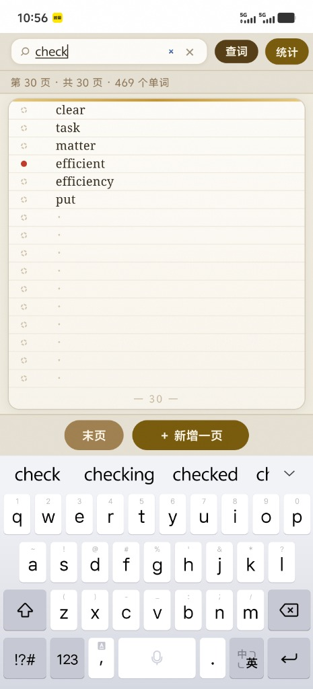
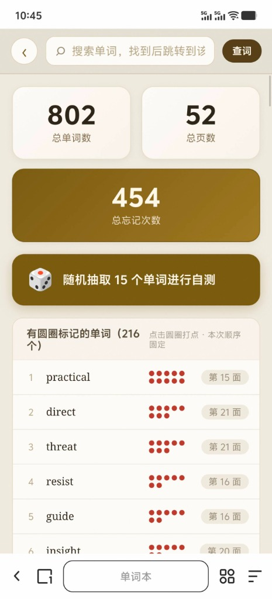

# 📖 Vintage Vocabulary Notebook (复古单词便签本)

<p align="center">
  
</p>

<p align="center">
  <b>专为高频背诵、教学抽测与多设备无缝漫游设计的沉浸式复古拟物单词本</b>
</p>

<p align="center">
  
  
  
  
  
  
</p>

---

## 📱 界面预览 (Screenshots)

<div align="center">
  <table>
    <tr>
      <td align="center" width="50%">
        <b>📖 复古纸张记词主界面</b><br/><br/>
        
      </td>
      <td align="center" width="50%">
        <b>🔍 内置双语词典与实时发音</b><br/><br/>
        
      </td>
    </tr>
    <tr>
      <td align="center" width="50%">
        <b>📊 统计页与教学考核抽测</b><br/><br/>
        <br/>
        <sub><i>(此处可放入统计页与 15 词盲测抽查截图)</i></sub>
      </td>
      <td align="center" width="50%">
        <b>☁️ 多端云同步与历史数据打捞</b><br/><br/>
        <br/>
        <sub><i>(此处可放入云同步设置或历史版本打捞弹窗截图)</i></sub>
      </td>
    </tr>
  </table>
</div>

---

## ✨ 核心特性 (Features)

### 1. 📜 沉浸式复古拟物纸张设计
- **经典实体纸质触感**：精调米黄复古纸张色泽与装订横线，搭配经典衬线字体排版。
- **16 格标准页面**：每页固定 16 个单词槽位，分页编号清晰，支持左右滑动手势拟真翻页。
- **快捷末页跳转**：底部常驻「末页」快速通道，支持随时扩展「＋ 新增一页」。

### 2. 🔴 艾宾浩斯圆圈打点记忆法
- **极简打点交互**：轻触单词左侧圆圈打点（`+1`），长按或右键撤销（`-1`），直观标记遗忘次数。
- **艾宾浩斯高频统计**：系统根据打点次数自动升序/降序归纳高频遗忘词。

### 3. 🎯 统计与教学抽测专属优化
- **考核冻结视图（Anti-Jitter）**：进入统计页时，单词排列顺序即刻固化。在考查学生过程中为单词点加圆圈时，**不会立即发生跳行抢位**，而是以醒目暖色高亮标记，二次进入统计页时才重新归位，专为教学抽测流畅体验定制。
- **🎲 15 词随机盲测**：支持随时随机抽取 15 个单词进入自测卡片，支持卡片内即时打点并一键回跳原文所在页。

### 4. ☁️ 全自动无感多端云同步 (Cloud Sync Engine)
- **零门槛 Serverless 存储**：原生集成 Vercel KV / Upstash Redis，只需设置一个 Sync Key 即可在手机、平板、电脑间实时漫游。
- **出厂防洗白卫兵 (Virgin Lock Guardrail)**：针对冷启动设备严密加锁，彻底杜绝空白设备逆向覆写云端数据的恶性 bug。
- **离线优先 (Offline First)**：本地即时响应，后台自动节流调度推送到云端。
- **云端安全快照**：每次云端写入均自动保留一份前置历史镜像备份。

### 5. 📖 内置极速词典 & 音标净化
- **实时释义查询**：无需离开单词本，一键查询英汉释义及词性。
- **真人语音朗读**：调用 Web Speech API 提供标准真人英音/美音发音。
- **移动端音标乱码净化**：内置音标字符替换清洗机制，彻底解决手机端音标显示为“豆腐块”方块乱码的顽疾。
- **一键智能收录**：自动检测单词本是否已收录该词，未收录时一键直接追加到单词本尾部首个空位。

### 6. 🛡️ 数据安全、迁移与自愈体系
- **一键纯文本导出/导入**：直接生成并下载 `.txt` 备份文件，解除浏览器复制到剪贴板的字数限制。
- **历史版本深度打捞工具**：内置本地全盘扫描引擎，可一键扫描并找回浏览器历史 localStorage 各版本的圆圈打点记录。
- **空白页自动自愈与清理**：在数据加载时智能清理断层空白页，统计页提供「🧹 清理空白页面」一键整理功能。

---

## 🛠️ 技术栈 (Tech Stack)

| 领域 | 技术方案 |
| :--- | :--- |
| **前端框架** | [Vue 3](https://vuejs.org/) (Composition API + `<script setup>`) |
| **构建工具** | [Vite 8](https://vitejs.dev/) |
| **状态管理** | [Pinia 4](https://pinia.vuejs.org/) |
| **路由管理** | [Vue Router 4](https://router.vuejs.org/) |
| **云端存储** | [Vercel KV](https://vercel.com/docs/storage/vercel-kv) / [Upstash Redis](https://upstash.com/) (Serverless REST API) |
| **数据持久化** | 本地 LocalStorage + 坚固版本迁移镜像 |
| **样式与动效** | 原生现代化 CSS3 拟物化设计，无外部臃肿 UI 库依赖 |

---

## 🚀 快速开始 (Quick Start)

### 1. 克隆项目
```bash
git clone https://github.com/LIKEASHOT/notebook.git
cd notebook
```

### 2. 安装依赖
```bash
npm install
```

### 3. 本地启动开发环境
```bash
npm run dev
```
打开浏览器访问 `http://localhost:5173` 即可开始使用。

### 4. 生产构建打包
```bash
npm run build
```

---

## 🌐 部署至 Vercel (Deployment)

本项目专为 Vercel 优化，开箱即用：

1. **导入仓库**：登录 [Vercel](https://vercel.com/)，点击 **Add New Project**，选择并导入本 GitHub 仓库。
2. **绑定 Vercel KV 数据库**：
   - 在 Vercel 项目控制台进入 **Storage** 标签页。
   - 点击 **Connect Database**，选择 **KV (Upstash)** 创建并关联至当前项目。
   - Vercel 会自动为项目注入环境变量（如 `KV_REST_API_URL` 与 `KV_REST_API_TOKEN`）。
3. **完成部署**：触发重新部署后，多设备云同步通道即可自动打通！

---

## 📁 目录结构 (Directory Structure)

```text
notebook/
├── api/
│   └── sync.js              # Vercel Serverless 云同步与快照备份接口
├── docs/
│   └── screenshots/         # 项目演示截图资源
├── src/
│   ├── assets/              # 静态图标与全局基础样式
│   ├── components/
│   │   └── DictModal.vue    # 双语词典查询与单词添加弹窗
│   ├── data/
│   │   └── initialPages.json# 内置权威初始单词本底库数据
│   ├── router/
│   │   └── index.js         # 前端页面路由配置
│   ├── store/
│   │   └── notebook.js      # Pinia 核心状态库（页面、打点、增删自愈）
│   ├── utils/
│   │   ├── dict.js          # 在线词典查询与音标过滤服务
│   │   ├── importer.js      # 导出/导入 txt 文本解析引擎
│   │   ├── storage.js       # localStorage 读写、版本迁移与历史打捞
│   │   └── sync.js          # 前端云同步引擎 (CloudSyncService)
│   ├── views/
│   │   ├── Home.vue         # 首页（拟物纸张、记词格、滑动浏览、打点）
│   │   └── Stats.vue        # 统计页（艾宾浩斯分析、盲测抽考、备份打捞）
│   ├── App.vue              # 根组件
│   └── main.js              # 入口文件
├── data.txt                 # 单词本标准导出数据备份样本
├── package.json
├── vercel.json              # Vercel 路由代理配置
└── vite.config.js
```

---

## 📄 开源许可证 (License)

本项目采用 [MIT License](LICENSE) 开源协议。
